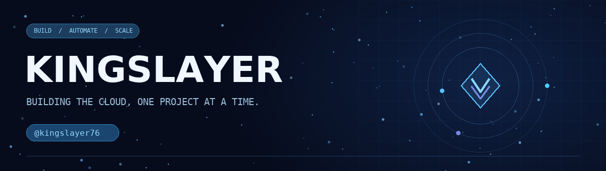

  

  ### ☁️ Cloud Infrastructure &nbsp; • &nbsp; 💻 Development &nbsp; • &nbsp; 🎮 Gaming

  

  **Creating practical tools, powerful panels, and better experiences for communities.**

  
  
  

  

 

## 👋 About Me

Hey, I'm **KingSlayer** — a developer and technology enthusiast who loves building websites, hosting panels, Discord bots, and tools that make infrastructure easier to manage. I enjoy working across the stack, from a polished user interface to the systems and automation behind it.

My interests bring together **cloud infrastructure, virtualization, Minecraft hosting, and community development**. Whether it's managing virtual servers, improving a panel, or automating a Discord workflow, I focus on practical solutions and a smooth user experience.

- ☁️ Building and exploring **cloud hosting, VPS platforms, and management panels**
- 🖥️ Working with **Proxmox, QEMU/KVM, LXC, and Linux environments**
- 🎮 Creating and managing **Minecraft servers and Pterodactyl-based hosting**
- 🤖 Developing **Discord bots, integrations, and automation**
- 🎨 Designing clean interfaces and continuously learning new technologies

## ⚡ What I Work On

### ☁️ Cloud & Virtualization
I work with virtual machines, containers, and server infrastructure, including **Proxmox, QEMU/KVM, and LXC**. My focus is on making VPS provisioning and day-to-day management more accessible through useful tools and dashboards.

### 🎮 Minecraft & Pterodactyl
I enjoy the world of **Minecraft server hosting** and **Pterodactyl Panel** — setting up and managing servers, exploring hosting workflows, and creating a better experience for players and communities.

### 🤖 Discord Bots & Automation
From community utilities to VPS management, I build and explore **Discord bots and integrations** that bring useful commands, administration, and automation closer to the people who need them.

### 💻 Web Development & Hosting Panels
I work on **websites and full-stack panels** with practical interfaces, dashboards, and server-side functionality. I care about clear design, maintainable workflows, and tools that solve real problems.

## 🛠️ Technologies & Tools

**Languages & web**

**Backend & data**

**Infrastructure & communities**

## 🚀 Featured Projects

### ☁️ [StarCloud-VM](https://github.com/kingslayer76/StarCloud-VM)
A web-based **QEMU/KVM virtual machine management panel** with separate admin and user dashboards. It brings VM management, OS templates, browser-based console and SSH, and file access together in one place.

`Node.js` &nbsp; `Express` &nbsp; `EJS` &nbsp; `QEMU / KVM`

### 🖥️ [StarCloud-HVM-PANEL](https://github.com/kingslayer76/StarCloud-HVM-PANEL)
An **LXC-based VPS management panel** for managing containers across nodes. Its hosting tools include a browser console, file manager, snapshots, and live resource monitoring.

`Python` &nbsp; `Flask` &nbsp; `LXC` &nbsp; `Multi-node`

### 🤖 [PRIME-VM-V1](https://github.com/kingslayer76/PRIME-VM-V1)
A **Discord VPS management bot** that connects hosting workflows to a community. Manage LXC containers and nodes, monitor resources, and use tools such as port forwarding and panel installation from Discord.

`Python` &nbsp; `Discord Bot` &nbsp; `LXC` &nbsp; `Automation`

  <a href="https://github.com/kingslayer76?tab=repositories"><b>Explore all my repositories →</b></a>

## 📊 GitHub Statistics

  
  
   
  
   
  

## 🌐 Connect With Me

Have an idea, a question, or want to talk about cloud hosting, Minecraft, or Discord bots? Let's connect!

- 💻 **GitHub:** [@kingslayer76](https://github.com/kingslayer76)
- 💬 **Discord username:** `KingSlayer76`
- 🌟 **Discord community:** [Join the server](https://discord.gg/Rk68XqtvNH)

 

  <b>⚡ BUILD &nbsp; • &nbsp; INNOVATE &nbsp; • &nbsp; SCALE ⚡</b> 
  Building with passion, always learning — KingSlayer.

